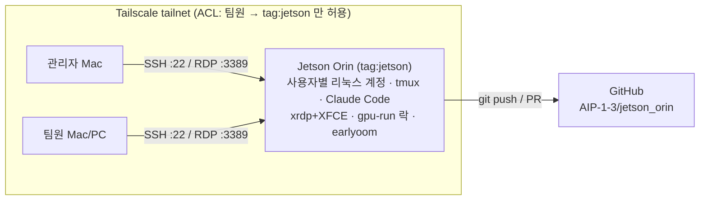

# jetson_orin

원격으로 공유하는 **NVIDIA Jetson Orin** 한 대에서 팀이 Claude Code 와 함께 개발하기 위한 환경 세팅 + 운영 저장소.



## 빠른 시작

### 관리자 (Jetson 소유자) — 순서대로

| # | 할 일 | 명령/문서 | 소요 |
|---|---|---|---|
| 1 | Tailscale ACL 적용 + Jetson 에 `tag:jetson` | [docs/01](docs/01-team-access.md) · `tailscale/policy.example.hujson` | 10분 |
| 2 | 저장소 clone (Jetson) | `git clone https://github.com/AIP-1-3/jetson_orin.git ~/jetson_orin` | 1분 |
| 3 | 성능/안정성 세팅 | `sudo ./scripts/setup-performance.sh --headless --disable-zram` | 5분 |
| 4 | 원격 데스크톱 서버 | `sudo ./scripts/setup-remote-desktop.sh` → `sudo reboot` | 10분 |
| 5 | 팀원 초대 + 계정 생성 | Tailscale *Invite users* → `sudo ./scripts/add-team-member.sh <id> --github <gh>` | 1인당 3분 |
| 6 | 비밀번호 SSH 차단 | `sudo ./scripts/secure-ssh.sh` (새 창으로 접속 테스트 후) | 2분 |
| 7 | `CLAUDE.md` 장비 정보 채우기 | `./scripts/healthcheck.sh` 결과 반영 → PR | 5분 |

### 팀원

1. Tailscale 앱 설치 → 초대 수락
2. SSH 공개키를 GitHub 에 등록하거나 관리자에게 전달
3. `config/ssh_config.example` → `~/.ssh/config`, 그다음 `ssh jetson`
4. Claude Code 설치 + 본인 계정 로그인 → [docs/04](docs/04-team-workflow.md)

## 구성

```
scripts/
  setup-performance.sh     전력모드 MAXN, jetson_clocks 상시 적용, NVMe 스왑, earlyoom, jtop, Docker nvidia 런타임, 헤드리스
  setup-remote-desktop.sh  xrdp + XFCE (Thincast 등 RDP 클라이언트로 접속)
  add-team-member.sh       팀원 계정 + GitHub 공개키 + GPU/Docker 그룹
  secure-ssh.sh            키 전용 SSH (잠금 사고 방지 검사 포함)
  gpu-run.sh               무거운 GPU 작업 팀 단위 순차 실행 (통합 메모리 OOM 방지)
  healthcheck.sh           상태 점검 (sudo 불필요)
config/                    tmux, ssh_config 예시
tailscale/                 ACL 정책 예시
docs/                      01 접속 · 02 원격 데스크톱 · 03 성능 · 04 팀 작업 방식
CLAUDE.md                  Claude Code 가 읽는 장비/팀 규칙
.claude/settings.json      재부팅·업그레이드 등 공용 장비 위험 명령 차단
```

모든 스크립트는 재실행해도 안전하게(idempotent) 작성했고, 설정 파일을 바꾸기 전에 `*.orig` 로 원본을 백업한다.
JetPack 5/6/7 과 Orin Nano/NX/AGX 를 자동으로 구분한다 (전력 모드 ID 등을 하드코딩하지 않음).
