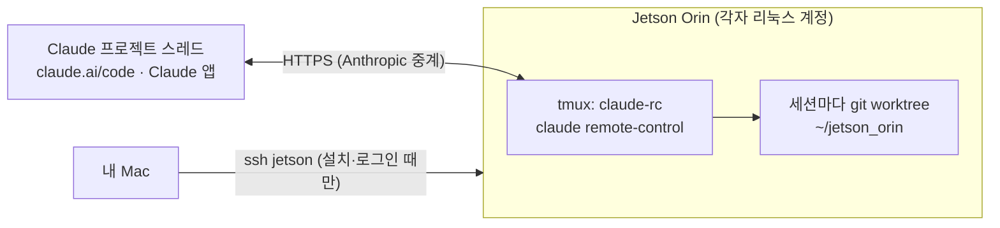

# 05. Jetson 을 Claude 프로젝트·앱에 연결하기 (Claude Code Remote Control)

Jetson 에서 Claude Code 를 **Remote Control 서버 모드**로 띄워 두면, 장비 앞에 없어도
claude.ai/code · Claude 앱 · Claude 프로젝트 스레드에서 이 장비로 세션을 열어
빌드·테스트·벤치마크·카메라 확인을 시키고 결과를 받아 볼 수 있다.



- 연결은 **Jetson → Anthropic 방향(아웃바운드 HTTPS)** 만 쓴다. Tailscale ACL 에 포트를 더 열 필요가 없다
  (현재 열린 22 / 3389 / 8000-8999 그대로). Jetson 이 인터넷(`claude.ai`, `api.anthropic.com`)에 나갈 수만 있으면 된다.
- 코드는 Jetson 에서 실행되고, 파일도 Jetson 에 남는다. 화면(대화)만 원격으로 본다.
- 계정은 공유하지 않는다. **각자 자기 리눅스 계정(minseo, seongchan …)에서 자기 Claude 계정으로** 서버를 띄운다.

## 0. 전제 조건

| 항목 | 조건 |
|---|---|
| 요금제 | Claude **Pro / Max / Team / Enterprise**. API 키 로그인은 Remote Control 이 안 된다 |
| Team·Enterprise | 조직 Owner 가 [admin settings › Claude Code](https://claude.ai/admin-settings/claude-code) 에서 **Remote Control** 토글을 켜 둬야 한다 |
| 장비 | Ubuntu 20.04+ / ARM64(aarch64) — Jetson(JetPack 5·6) 공식 지원 범위, RAM 4GB+ |
| 프로그램 | `tmux`, `git`, `curl` (JetPack 기본 또는 `setup-performance.sh` 가 설치) |

## 1. 설치 (맥 터미널에서 그대로 붙여넣기)

```bash
ssh jetson
tmux new -A -s setup                                    # 설치 중 SSH 가 끊겨도 안전하게

curl -fsSL https://claude.ai/install.sh | bash          # ~/.local/bin/claude 에 설치, ARM64 자동 선택, 자동 업데이트
grep -q '.local/bin' ~/.bashrc || echo 'export PATH="$HOME/.local/bin:$PATH"' >> ~/.bashrc
source ~/.bashrc
claude --version                                        # 예: 2.1.xxx (Claude Code)
claude doctor                                           # 설치 상태 점검
```

sudo 가 필요 없고 자기 홈 디렉터리에만 설치된다 (`apt`/`npm -g` 를 쓰지 않으므로 공용 장비에 영향 없음).

## 2. 로그인 (claude.ai 계정)

```bash
claude auth login       # "Claude account (claude.ai)" 쪽을 고른다
```

Jetson 에는 브라우저가 없으므로 터미널에 **로그인 URL** 이 출력된다. 그 URL 을 맥 브라우저에서 열어
로그인한 뒤, 화면에 나온 코드를 Jetson 터미널에 붙여넣는다.

- `ANTHROPIC_API_KEY` 를 `~/.bashrc` 등에 넣어 두었다면 지운다 (있으면 Remote Control 이 거부된다).
- `claude setup-token` 으로 만든 장기 토큰도 Remote Control 에는 못 쓴다 — 반드시 `claude auth login`.

## 3. 저장소 준비

```bash
[ -d ~/jetson_orin ] || git clone https://github.com/AIP-1-3/jetson_orin.git ~/jetson_orin
cd ~/jetson_orin && git pull
```

## 4. 첫 실행 — 화면에 붙어서 질문 두 개에 `y`

```bash
cd ~/jetson_orin
./scripts/claude-rc.sh start
```

1. `Trust /home/<아이디>/jetson_orin? [y/N]` → `y` (폴더 신뢰, 한 번만 묻는다)
2. `Enable Remote Control? (y/n)` → `y` (계정당 한 번만 묻는다)
3. 세션 URL 이 뜨면 성공. 스페이스바를 누르면 휴대폰용 QR 코드가 나온다.
4. **`Ctrl-b` 다음 `d`** 로 빠져나온다. 서버는 tmux 안에서 계속 돈다. 이제 `exit` 로 SSH 를 끊어도 된다.

> 질문 두 개는 터미널이 있어야 답할 수 있다. 그래서 첫 실행은 꼭 이렇게 화면에 붙어서 하고,
> 그다음부터는 `--detach` 나 systemd(아래 6번)로 띄워도 된다.

`claude-rc.sh` 가 실제로 실행하는 명령:

```bash
claude remote-control --name jetson-<아이디> --spawn worktree --capacity 3
```

| 옵션 | 기본값 | 이유 |
|---|---|---|
| `--name` | `jetson-<아이디>` | claude.ai 세션 목록에서 누구의 Jetson 서버인지 바로 보이게 (`RC_NAME` 으로 변경) |
| `--spawn worktree` | worktree | 스레드·세션마다 별도 git worktree → 동시에 두 작업이 같은 파일을 덮어쓰지 않는다 (`RC_SPAWN=same-dir` 로 변경) |
| `--capacity 3` | 3 | 세션마다 Claude Code 프로세스가 메모리를 쓴다. 통합 메모리라 GPU 작업 몫을 남겨 둔다 (`RC_CAPACITY`) |
| `--permission-mode` | 지정 안 함 | 명령·파일 수정마다 앱에서 승인. 익숙해지면 `RC_PERMISSION_MODE=acceptEdits` |

프로세스가 죽으면(네트워크 장시간 끊김 등) 30초 뒤 자동으로 다시 띄우고, 같은 폴더라 직전 세션들이 그대로 돌아온다.

## 5. 연결 확인

- **claude.ai/code** 또는 Claude 앱 세션 목록에 `jetson-<아이디>` 가 보이면 된다.
- **Claude 프로젝트**: 프로젝트 채팅에 "Jetson 에서 `./scripts/healthcheck.sh` 돌려 줘" 처럼 요청하면,
  Claude 가 이 장비의 `~/jetson_orin` 폴더로 세션을 시작해도 되는지 묻는 카드를 띄운다 → 허용하면 스레드에서 Jetson 작업이 이어진다.
  장비가 목록에 안 보이면 프로젝트의 **Remote Control 설정**에서 연결된 장비를 확인한다.

```bash
./scripts/claude-rc.sh status    # 실행 여부 + 최근 출력 15줄
./scripts/claude-rc.sh attach    # 서버 화면 보기 (Ctrl-b d 로 빠져나오기)
./scripts/claude-rc.sh stop      # 끄기
```

## 6. 끊겨도 계속 돌게 하기

| 방법 | SSH 끊김 | 로그아웃 | 재부팅 | 필요한 것 |
|---|---|---|---|---|
| **A. tmux (기본)** — `claude-rc.sh start` | 유지 | 유지 | 꺼짐 → 다시 `start` | 없음 |
| **B. systemd 사용자 서비스** — `config/claude-rc.service` | 유지 | 유지 | 자동 시작 | 관리자가 `loginctl enable-linger` 한 번 |

B 설치 (4번 첫 실행으로 질문 두 개에 답한 뒤에):

```bash
mkdir -p ~/.config/systemd/user
cp ~/jetson_orin/config/claude-rc.service ~/.config/systemd/user/
./scripts/claude-rc.sh stop                      # tmux 로 띄운 것은 끄고 서비스로 넘긴다
systemctl --user daemon-reload
systemctl --user enable --now claude-rc
systemctl --user status claude-rc --no-pager
# 관리자 (팀 합의 후, 계정별 한 번): sudo loginctl enable-linger minseo
```

서비스로 띄워도 tmux 안에서 돌기 때문에 `./scripts/claude-rc.sh attach` 로 화면을 볼 수 있다.

## 7. 공용 장비 규칙 (Remote Control 에도 그대로 적용)

- 원격 세션도 이 저장소의 `CLAUDE.md` 와 `.claude/settings.json` 을 읽는다 → 재부팅·전력 모드·apt upgrade 등은 그대로 차단된다.
- 무거운 GPU 작업은 원격에서도 `./scripts/gpu-run.sh -- <명령>` 으로만 (팀 단위 순차 실행).
- 안 쓰는 날은 `./scripts/claude-rc.sh stop`. 서버 하나는 대기 중에도 메모리를 조금 쓴다.
- 앱에서 뜨는 권한 요청(명령 실행, 파일 수정)은 내용을 보고 승인한다. 휴대폰 알림은 Claude Code `/config` 에서 켤 수 있다.

## 8. 문제 해결

| 증상 | 원인 → 해결 |
|---|---|
| `You must be logged in to use Remote Control` | 로그인 안 됨 → `claude auth login` |
| `Remote Control requires a claude.ai subscription auth` + `ANTHROPIC_API_KEY is set` | API 키가 우선 적용됨 → `~/.bashrc`·`~/.claude/settings.json` 의 `env` 에서 제거 |
| `Remote Control requires a full-scope login token` | `setup-token` 토큰 사용 중 → `claude auth login` |
| `Remote Control is disabled by your organization's policy` | Team/Enterprise 에서 토글 꺼짐 → Owner 에게 요청. 개인 요금제라면 `claude auth logout` 후 다시 로그인 |
| `Workspace not trusted` | 질문에 답할 터미널이 없음 → 4번처럼 `start`(화면에 붙기)로 한 번 `y` |
| `claude: command not found` | PATH 미설정 → 1번의 `~/.bashrc` 줄 추가 후 `source ~/.bashrc` |
| 세션 목록에 안 보임 | `./scripts/claude-rc.sh attach` 로 오류 확인. 더 자세히: `claude remote-control --verbose` |
| 서버가 계속 재시작됨 | `status` 출력의 종료 코드·메시지 확인 → 대부분 위의 로그인 문제 |

## 참고

- [Remote Control 공식 문서](https://code.claude.com/docs/en/remote-control)
- [Claude Code 설치·시스템 요구사항](https://code.claude.com/docs/en/setup)
